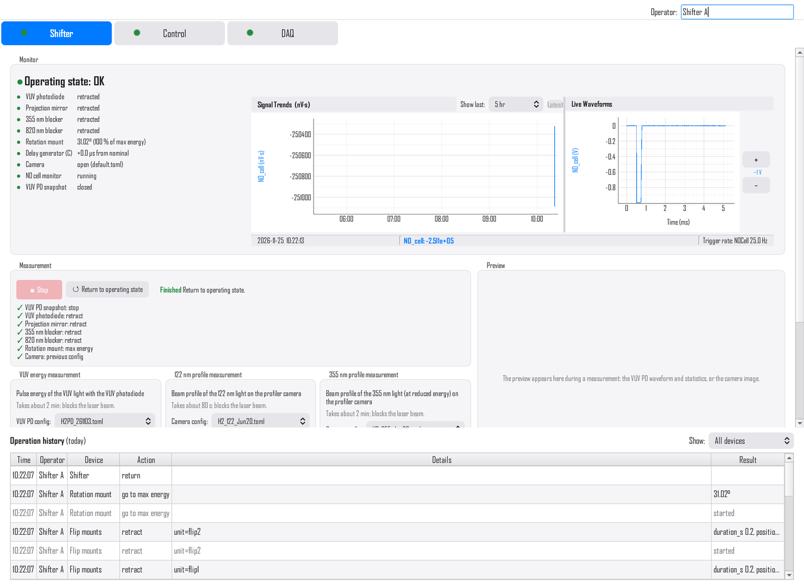
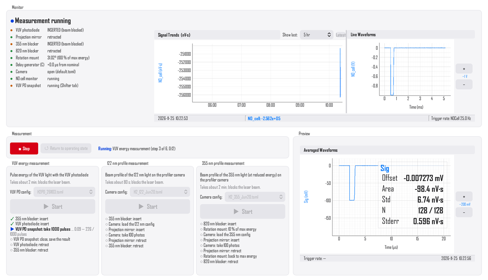
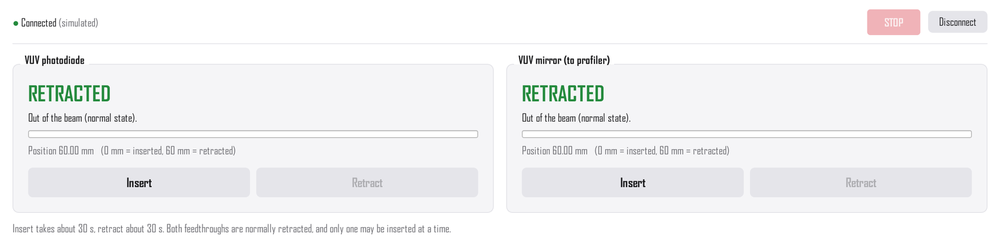
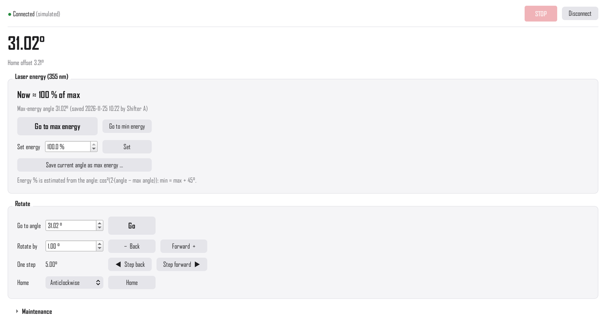
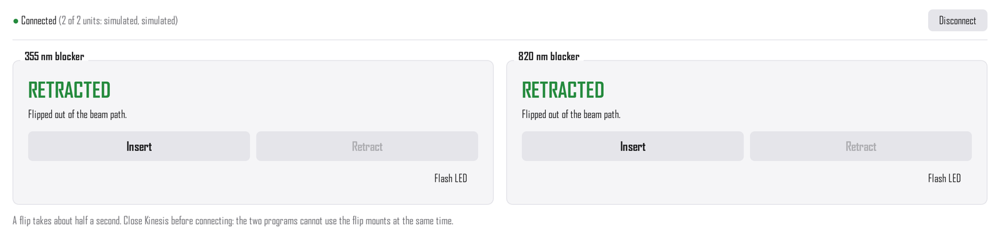
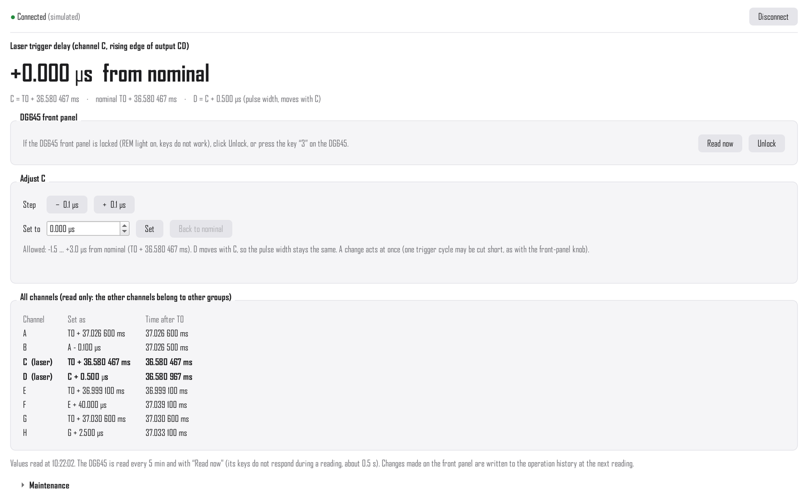
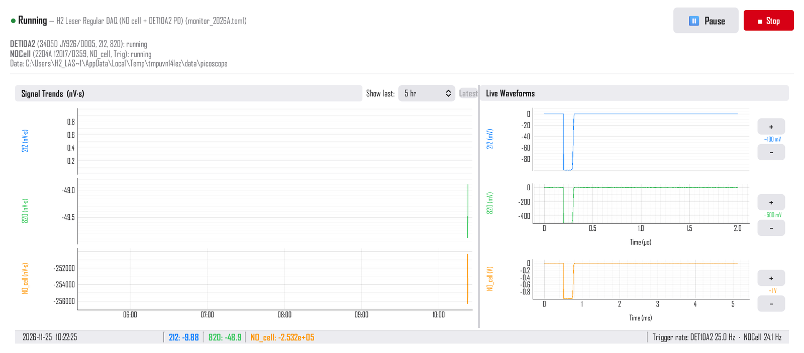
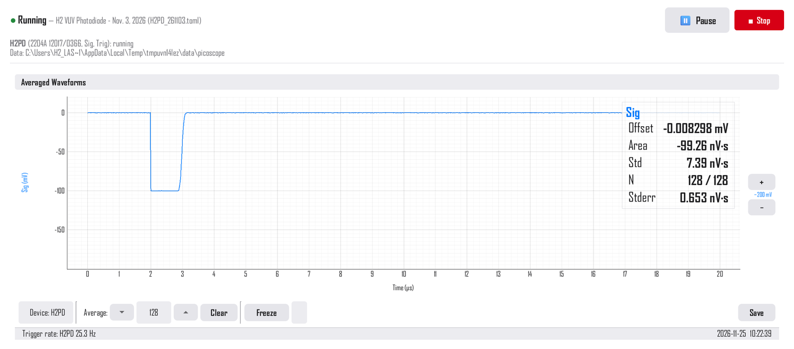
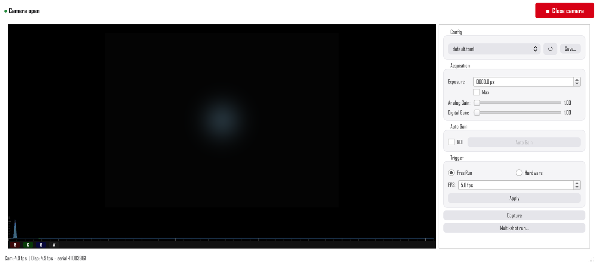

# H2 Laser Control — User Manual

*Meng Lyu, The University of Tokyo*

*For shifters and other users of the H2 laser room. Version 2026-11-25.*

## Preface

**H2 Laser Control** is the program for running the H2 laser room devices from one window.
Its purpose is to make routine work, such as measuring the VUV energy or a beam profile,
safe and simple: one click instead of many manual steps.

> **Safety.** The VUV feedthroughs sit in vacuum on a live beamline. *Insert* puts a photodiode
> or mirror into the beam and blocks it. Only insert when the beamline situation allows it.

**Start:** double-click `H2LaserControl.bat` on the desktop (or `H2LaserControl-simulation.bat`
to practise: nothing moves, a yellow banner says *SIMULATION*). Close SGSample, ELLO, Kinesis,
PicoScope 7 and IDS peak Cockpit first: they block the devices.

- **Operator** (top right): type your name. Every action is logged with it.
- **Three tabs:** **Shifter** (everyday work, opens at start), **Control** (devices that move or
  set something), **DAQ** (scopes and camera).
- **Dot on each tab:** green = OK, blue = working, grey = off / closed, red = problem.
- **Operation history** (bottom): everything done today, by whom, and the result. Use **Show**
  to filter by device.

## Shifter panel

**Monitor** (top): is the setup in the **operating state**? Each line shows one device; a
green dot means it is where it should be (all blockers and feedthroughs retracted, full 355 nm
energy, camera open, NO cell monitor running). The NO cell trend and live waveform are on the
right; choose the time span with **Show last**.

**Measurements** — three boxes:

| Box | What it does | Time |
|---|---|---|
| VUV energy | 355 nm blocked, VUV photodiode in, 1000 pulses, all back | ~2 min |
| 122 nm profile | 355 nm blocked, mirror in, 100 camera photos, mirror out | ~80 s |
| 355 nm profile | 820 nm blocked, energy to 10 %, 100 photos, everything back | ~2 min |

1. Choose the config in the box (the default is usually right).
2. Press **Start** and confirm. Start works only from the operating state; otherwise the box
   says which device is not ready.
3. Watch the step list (✓ done, ▶ running) and the **Preview** (waveform or camera image).
4. When it finishes, the result appears in the box (VUV: area ± error; profile: photo folder)
   and the setup is back in the operating state.

**Stop** halts the measurement at once and leaves everything where it is (the beam may still be
blocked). Then press **Return to operating state**: it stops the VUV photodiode scope, retracts
both feedthroughs and both blockers, sets full energy and restores the camera config.

While a measurement runs, the device tabs it uses are locked.

**Results:** VUV energy → `data/picoscope/snapshots/` (CSV) and `data/picoscope/root/` (ROOT);
photos → `data/camera/<date>/`.

## Control

Devices connect by themselves at start. Each sub-tab has **Disconnect / Connect** at the top
right and, where a move can be stopped, a red **STOP**.

### VUV feedthroughs

Two vacuum feedthroughs: the **VUV photodiode** and the **VUV mirror** (to the profiler camera).

- **Insert** / **Retract**; a move takes about 30 s. The bar shows the progress.
- Normal state: both **RETRACTED**. Only one can be inserted at a time.
- **STOP** stops a move halfway.
- *POSITION UNKNOWN*: the controller lost its position (power cut). Call an expert.

### Rotation mount

Half-wave plate that sets the **355 nm laser energy**.

- **Go to max energy** — the normal state. **Go to min energy** for minimum.
- **Set energy** — type a percentage and press **Set** (estimated from the angle).
- **Rotate** — go to an angle, rotate by an amount, step, or home. Normally not needed.
- **Save current angle as max energy** — experts only, when the max-energy angle has changed
  (the energy % and the Shifter tab use it).
- **Maintenance** (collapsed) — experts only.

### Flip mounts

Two beam blockers on the optical bench.

- **355 nm blocker** inserted: only 122 nm reaches the profiler.
- **820 nm blocker** inserted: no 122 nm is produced; only 355 nm reaches the profiler.
- **Insert** / **Retract** take half a second. Normal state: both **RETRACTED**.
- **Flash LED** blinks the unit, to find it on the bench.

### Delay generator

The DG645 sets the **laser trigger delay** (channel C). The big number is the offset from the
nominal value; normally **+0.000 µs**.

- **Adjust C**: **− / +** steps by 0.1 µs; or type a value in **Set to** and press **Set**.
  **Back to nominal** returns to 0. The allowed range is shown below; larger values are refused.
- **All channels**: read only. The other channels belong to other groups — never change them.
- **Read now** reads all channels. The DG645 is also read every 5 min.
- **Unlock**: if the DG645 front-panel keys do not work (REM light on).
- **Maintenance** (collapsed) — experts only (changes the nominal value).

## DAQ

The DAQ devices start only when you press **Start**. Each keeps running while you use other
tabs, until you press **Stop**. Close PicoScope 7 and IDS peak Cockpit first.

### Scope monitor

Continuous monitor of the NO cell and the photodiodes. **It should always run during beam
operation.**

- Choose the **Config**, press **Start**. **Pause** stops taking data for a moment;
  **Stop** closes the files and the scopes.
- **Signal Trends** (left): pulse area vs time. **Show last** sets the time span;
  **Latest** follows new data again after zooming.
- **Live Waveforms** (right): the last pulse; **+ / −** change the vertical range.
- Bottom line: latest values and trigger rate. Data go to `data/picoscope/`.

### VUV PD snapshot

The VUV photodiode, averaged. Used by the Shifter VUV measurement; use it by hand only when
the photodiode is inserted.

- Choose the **Config**, press **Start**; **Stop** when done.
- The box shows offset, area, its spread (**Std**) and error (**Stderr**) over the last **N**
  pulses.
- **Average** ▼/▲ sets N; **Clear** restarts the average; **Freeze** keeps the curve as a
  dashed reference; **Save** writes the waveform and statistics to
  `data/picoscope/snapshots/`.

### Camera

The beam profiler camera. **Keep it open during operation** (the Shifter profile measurements
need it). Avoid closing and reopening it often: the USB link can drop, and the camera then
must be re-plugged.

- **Start camera** opens it; **Close camera** closes it.
- **Config**: choose a saved setting (exposure, gain, trigger); **Save…** stores the current
  one.
- **Exposure**, **Gain**: adjust the image. **Auto Gain**: tick **ROI**, drag the box over the
  spot, press **Auto Gain**.
- **Trigger**: **Free Run** (camera's own rate, **FPS**) or **Hardware** (laser trigger);
  press **Apply**.
- **Capture** saves one image; **Multi-shot run…** saves N images. Images go to
  `data/camera/<date>/`.
- The histogram (bottom left) shows saturation: avoid a peak at the right edge.
